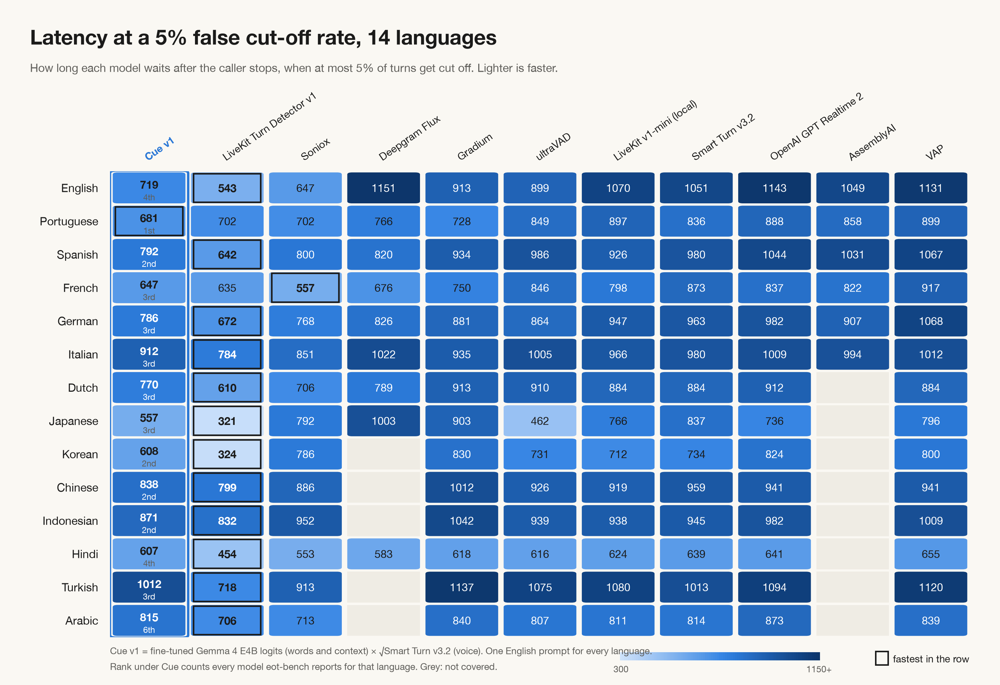

# Cue v1

**Cue v1 is turn detection for voice agents that combines context and audio:**

> **Cue v1 = the fine-tuned Gemma 4 E4B's logits (the words and context) × √Smart Turn v3.2 (the voice)**

Combining the two gives better and faster results than either one alone. On LiveKit's eot-bench, with one model and
one English prompt across 14 languages: **4th in English · 1st in Portuguese · about 13 decisions a second on one T4.**

- **Weights (the Gemma part):** [huggingface.co/Pype/cue-v1](https://huggingface.co/Pype/cue-v1): `cue-v1-q8_0.gguf`
  for llama.cpp, and the LoRA adapter
- **The voice part:** Smart Turn v3.2 by Pipecat (BSD-2), not included:
  [pipecat-ai/smart-turn-v3](https://huggingface.co/pipecat-ai/smart-turn-v3)
- **This repo:** a small client, a LiveKit turn detector ([`LIVEKIT.md`](LIVEKIT.md)), the prompts, every benchmark
  prediction with a script that checks our numbers with LiveKit's own harness, the full analysis in
  [`RESULTS.md`](RESULTS.md), and the training recipe
- **Works best with [Shortwire](#part-of-shortwire).** We'll share more details soon.


## What it decides

The Gemma part is Gemma 4 E4B, fine-tuned to answer two typed questions: *when the caller pauses, are they done, and if
not, why not?* and *when the caller speaks over the agent, should the agent stop?* Each answer is read from the logits
as probabilities over named states, so the agent knows not only *whether* to act but *how long to wait* and *whether
it was really interrupted*:

| | Answer | What it means | What the agent does |
|---|---|---|---|
| **End of turn** (the caller pauses) | **DONE** | A complete question, answer, request or statement | Reply now |
| | **LIKELY_DONE** | Probably finished, but it trails off | A short grace, then reply |
| | **MID_THOUGHT** | The sentence is left hanging: "my number is nine eight four five..." | Keep listening |
| | **HOLDING** | Telling a story or explaining something: the pause is thinking | Keep listening, longer |
| **Interruptions** (the caller speaks while the agent talks) | **STOP** | A real interruption: a question, a correction, "wait", "hello?" | Stop talking and listen |
| | **CONTINUE** | Only listening: "hmm", "okay", laughter, noise, a fragment | Keep talking |

## Context and audio together

The Gemma part brings the **context**: what the agent asked, what the caller has said, whether a sentence or a number
has been left hanging. It does not hear the voice. Smart Turn hears the voice (a falling tone, a breath) but not the
meaning. Together they beat either one alone:

| eot-bench, English | Latency @5% | Latency @10% | Cut-offs @300 ms | Cut-offs @600 ms |
|---|---|---|---|---|
| Smart Turn v3.2 only (audio) | 1,051 ms | 739 ms | 35.2% | 14.8% |
| Gemma part only (words and context) | 750 ms | 552 ms | 34.0% | 7.8% |
| **Cue v1 (both)** | **719 ms** | **532 ms** | **26.8%** | **7.5%** |

Across all 14 languages, adding the voice makes it faster in 12 of 14 at both budgets. The combination is one line:
`p_end × √p_voice`.

## How it decides: logits, not text

The model never writes an answer. At every pause it is asked one question whose options are letters (A = DONE,
B = LIKELY_DONE, C = MID_THOUGHT, D = HOLDING), computes **one token** (`max_tokens: 1`, `logprobs: true`), and the
probability of each letter is read and renormalised. The answer is always one of the options, it comes as a full
distribution rather than a label, and it takes one forward pass. The fine-tune only moved where the probability goes
(the base Gemma almost never put it on HOLDING); it is still an ordinary Gemma 4 E4B that llama.cpp, Ollama or vLLM
can serve.

## Quick start

```bash
pip install -e .
huggingface-cli download Pype/cue-v1 cue-v1-q8_0.gguf --local-dir .
llama-server -m cue-v1-q8_0.gguf -c 8192 -np 4 -ngl 999 --jinja --port 8090
python examples/quickstart.py
```

```
"Sure, it's nine eight four five,"                   -> MID_THOUGHT  p(done) 0.00, wait 1.75 s
"It's nine eight four five six seven one two three four." -> DONE         p(done) 1.00, wait 0.51 s
'So last week I went to the clinic and the doctor told me that' -> MID_THOUGHT  p(done) 0.00, wait 1.75 s
agent talking, caller says "wait, Tuesday doesn't work"   -> STOP (0.998)
agent talking, caller says 'hmm'                          -> CONTINUE (1.000)
```

In your own code:

```python
from cue import Cue, ending, load, p_end, wait, with_voice

cue = Cue("http://localhost:8090/v1")
eot = load("prompts/end_of_turn_phone.json")

caller = "Sure, it's nine eight four five,"
probs = cue.ask(eot, {"agent_question": "What's the best number to reach you on?", "caller_earlier": "",
                      "caller_text": caller, "transcript_end": ending(caller)})
# {'DONE': 0.0, 'LIKELY_DONE': 0.0, 'MID_THOUGHT': 1.0, 'HOLDING': 0.0}

p_end(probs)               # the Gemma part: p(the caller is done) = DONE + LIKELY_DONE
with_voice(probs, 0.8)     # Cue v1: p_end x sqrt(Smart Turn's score for this moment)
wait(probs)                # two people talking: seconds of silence to wait, blended by the answer
```

`cue.aask(...)` is the async version. Any OpenAI-compatible server that returns `logprobs` works (llama.cpp, vLLM).

- **Caller and agent:** reply when `with_voice(probs, p_voice)` crosses a threshold you choose on your own calls for the
  cut-off rate you can accept. This is the setup behind every eot-bench number here.
- **Two people talking:** wait `wait(probs)` seconds of silence, and use the Gemma part alone: in our two-person tests,
  adding Smart Turn made it slightly worse.
- **Interruptions:** ask `prompts/barge_in.json` with what the agent is saying and the caller's words; stop when
  p(STOP) ≥ 0.5, and ask again as more words arrive.

## Use it in LiveKit

Cue v1 drops into a [LiveKit Agents](https://github.com/livekit/agents) voice agent as its turn detector:

```python
from cue.livekit import CueTurnDetector

session = AgentSession(..., turn_handling={"turn_detection": CueTurnDetector("http://localhost:8090/v1"),
                                           "endpointing": {"min_delay": 0.3, "max_delay": 2.0}})
```

Optionally, it also adds Smart Turn v3.2 on the caller's audio (the benchmarked recipe) and lets Cue decide
barge-in ("wait, which doctor?" stops her, "hmm" doesn't). The guide, with code for each: **[LIVEKIT.md](LIVEKIT.md)**.
A complete agent: [`examples/livekit_agent.py`](examples/livekit_agent.py).

## Prompts

The prompts are part of the model. Each is a JSON decision: an instruction, the options and what they mean, the
inputs it reads, and optional worked examples. `cue.messages(decision, inputs)` renders it exactly as Cue v1 was
trained and benchmarked (`tests/` check this byte for byte).

| File | Use |
|---|---|
| `prompts/end_of_turn_phone.json` | End of turn, a caller and an agent (the eot-bench prompt, with 11 English examples) |
| `prompts/end_of_turn_dialogue.json` | End of turn, two people talking |
| `prompts/barge_in.json` | Interruptions: STOP or CONTINUE while the agent is speaking |

## Results: LiveKit's eot-bench

All 400 English caller turns and every turn in 13 more languages, scored with the benchmark's own harness.

| English | Latency @5% | Latency @10% | Cut-offs @300 ms | Cut-offs @600 ms |
|---|---|---|---|---|
| LiveKit turn-detector v1 (hosted) | 543 ms | 295 ms | 9.9% | 4.5% |
| Baton v1 | 577 ms | 350 ms | 12.3% | 4.8% |
| Soniox | 647 ms | 512 ms | – | 5.5% |
| **Cue v1** | **719 ms** | **532 ms** | **26.8%** | **7.5%** |
| Cue v1, Gemma part only | 750 ms | 552 ms | 34.0% | 7.8% |
| ultraVAD | 899 ms | 663 ms | 27.7% | 11.9% |
| Smart Turn v3.2 | 1,051 ms | 739 ms | 35.2% | 14.8% |
| LiveKit turn-detector v1-mini (local) | 1,070 ms | 698 ms | 27.8% | 12.1% |
| OpenAI GPT Realtime 2 | 1,143 ms | 824 ms | – | – |
| Deepgram Flux | 1,151 ms | 548 ms | 12.9% | 9.9% |

Cue v1 is **4th of 13 on all four views**. Below about 600 ms LiveKit's hosted model is clearly better; **at a
one-second budget the two cut off callers equally rarely (1.8% each).**

Across the 14 languages, with the same English prompt: **1st in Portuguese** (681 ms against 702 ms for LiveKit v1
and Soniox), **2nd in Spanish, Korean, Chinese and Indonesian**, top 4 in 13 of 14. Faster than Smart Turn v3.2 in 26
of 28 language × budget comparisons and ultraVAD in 25 of 28. Still behind LiveKit's hosted model in all but one.
Every language, every view, and what helped and what didn't: [`RESULTS.md`](RESULTS.md).



<details>
<summary>The other views: cut-offs at 300 ms and 600 ms, latency at 10%</summary>


</details>

### Check our numbers

`results/eot_bench/runs/<language>/` holds, in the harness's own format (predictions, manifest, metrics), every run
behind the numbers above:

| Folder | What it is |
|---|---|
| `cue_v1/` | Cue v1: the published predictions |
| `cue_v1_gemma_part/` | The fine-tune's words-only scores, before the voice is added |
| `smart_turn_v3.2/` | Smart Turn v3.2 run by us on the same moments: the voice half |
| `cue_v1_on_base_gemma/` | The same recipe on the base Gemma, for the fine-tune comparison |

No GPU or model needed. One script recomputes every run's metrics with LiveKit's harness, rebuilds Cue v1 from its two
halves, and ranks it against the published models:

```bash
git clone https://github.com/livekit/eot-bench && pip install -e eot-bench
python results/eot_bench/verify.py --harness eot-bench
# ... Cue v1: 4 of 13 in English; 1 of 11 in Portuguese
# ALL CHECKS PASS
```

### Reproduce from scratch

```bash
git clone https://github.com/livekit/eot-bench && pip install -e eot-bench -e ".[eval]"
# the Gemma part (the model served as above), every turn of every language
python eval/eot_bench/run.py --harness eot-bench --rows 0 --lang en ar de es fr hi id it ja ko nl pt tr zh
# Smart Turn v3.2 on the same moments
python eval/eot_bench/run.py --harness eot-bench --rows 0 --lang en ar de es fr hi id it ja ko nl pt tr zh \
    --reference eot_harness.smart_turn_adapter:SmartTurnAudioAdapter
# combine (Gemma part x sqrt Smart Turn), rank against every published model, draw the heatmaps
python eval/eot_bench/leaderboard.py --harness eot-bench
```

Each run prints its model calls and how many failed; a failed call scores 0, so check that it says `(0 failed)`.
llama.cpp is not bit-exact when it serves several requests at once: a rerun matches the published scores to within
about 0.003 on average, which does not move the ranks.

## Speed and cost

**The eot-bench latencies are not hardware speed.** They measure *when* Cue v1 decides, counted from when the caller
actually stopped, and come out the same on any hardware as long as each decision is ready in time (the benchmark
assumes words arrive 0.5 s after they're spoken). On slow hardware, a late decision makes the real wait longer.

**Turn detection runs on Gemma logits: one token, no generation**, with the long prompt cached across calls. One
NVIDIA T4 (llama.cpp, q8_0) answers about **13 decisions a second**, 79 ms each one at a time and under 200 ms two at
once. At about six questions per caller turn (eot-bench's average) and an assumed six caller turns a minute, that is
roughly 20 concurrent calls per T4, about $0.0005 per call-minute. An estimate: measure your own call pattern.
Smart Turn v3.2 runs on the CPU. Full table in [`RESULTS.md`](RESULTS.md#speed-and-cost).

## Training

Cue v1's Gemma part never saw a real recording or a benchmark transcript. It was trained on **310 conversations
written by an LLM** to a written specification (`training/SPEC.md`): 150 phone calls between a caller and an agent and
160 two-person conversations, each on a different topic, with about 10,600 labelled pauses and about 1,000 listener
sounds (backchannels and real interruptions). The mix was shaped by a few aggregate statistics of TurnBench's public
dev split (how often a pause is a hold, how often a hold follows a complete sentence, how often a turn ends without
punctuation); no benchmark audio, transcript or label was used as an example.

```bash
python training/validate.py conversations/*.jsonl              # check a batch against the spec
python training/build.py --lean --v5 conversations/*.jsonl     # -> train_lean_v5.jsonl, test_lean_v5.jsonl
python training/train_unsloth.py --train train_lean_v5.jsonl --test test_lean_v5.jsonl --out cue-v1 --gguf merged
python training/eval_letters.py test_lean_v5.jsonl              # held-out accuracy against a served model
```

- LoRA rank 16 on Gemma 4 E4B (4-bit) with Unsloth, the loss on the answer letter only, one epoch, one NVIDIA T4
  (float32, about 2.5 hours). `--gguf merged` writes 16-bit merged weights for llama.cpp's `convert_hf_to_gguf.py`.
- Held out (10% of conversations, never trained on), against the base model with the same prompts:

  | | Base Gemma 4 E4B | Cue v1's Gemma part |
  |---|---|---|
  | Exact answer, every held-out question | 38.3% | **83.2%** |
  | End of turn: done vs not done | 58.2% | **86.9%** |
  | Interruptions: STOP vs CONTINUE (90 questions) | 93.3% | **98.9%** |

- We also tried Unsloth's decision-model head (`FastDecisionModel`) on the same data: 72.2% exact after one epoch,
  behind the letter fine-tune and not servable by llama.cpp, so Cue v1 uses the letter fine-tune.
- The 310 conversations themselves are not published; the spec and scripts are.

## Limits

- **The Gemma part reads words, not prosody.** That is what Smart Turn adds in Cue v1; the Gemma part alone gives the
  slower "Gemma part only" numbers.
- **Short objections can pass as backchannels.** "Hmm, actually no" said over the agent comes back CONTINUE (0.94).
- **Fast budgets.** Under about 600 ms, Cue v1 cuts off more callers than the leaders (26.8% at 300 ms in English).
- **Needs an ASR and a GPU.** Not an on-device model.
- **Trained on English.** The other 13 languages run on the English prompt; Arabic is the weakest (6th).
- **Trained on simulated conversations.** Measure it on your own calls before relying on its probabilities.

## Part of Shortwire

Cue is the turn engine in **Shortwire**, Pype's open source voice AI stack. Shortwire splits a call in two:

- **Background decision models handle how the call moves:** when the caller is done, when to hold, when to stop
  talking, what to guard against, when a number is being dictated, which tool to call.
- **The foreground LLM focuses on the talking:** what the agent says.

Every decision the cascade makes is auditable: each one is logged with its answer and probability, and can be replayed
after the call. In Shortwire, MID_THOUGHT and HOLDING are what we call **Thought Hold**, and the record of every
decision is the **Decision Trace**. *Knows when to wait. Knows when to stop.*

**Cue v1 works best with Shortwire.** We'll share more details soon.

## Licence

Apache 2.0 (`LICENSE`), the same as Gemma 4 E4B. See `NOTICE`. To cite Cue v1, see `CITATION.cff`.
