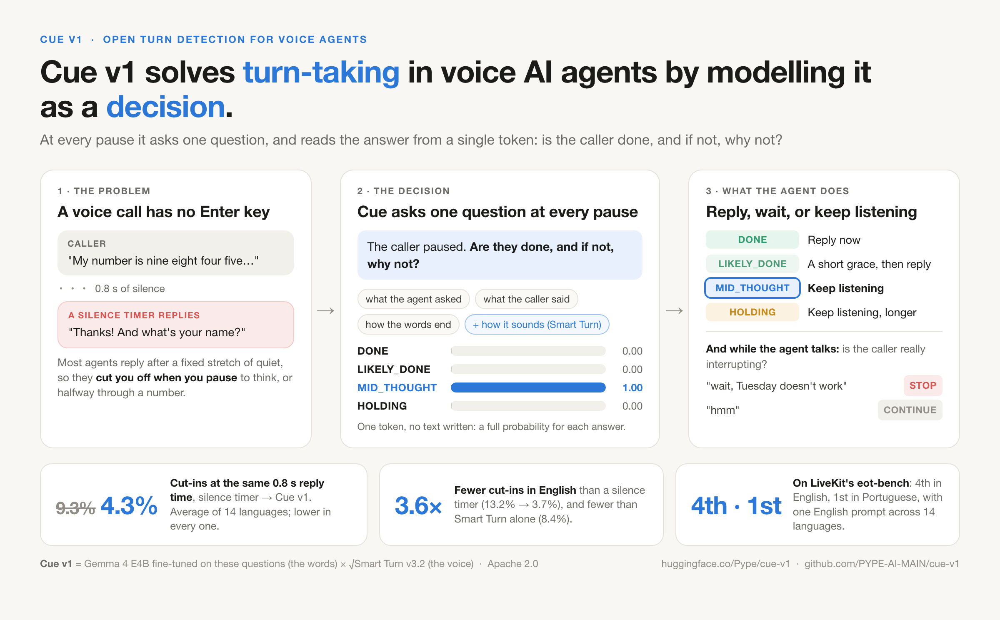
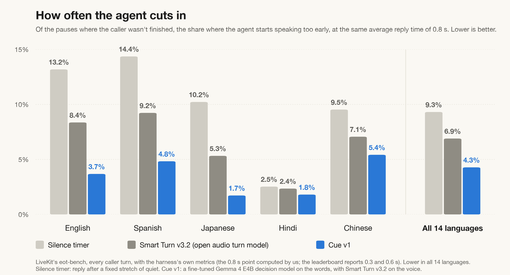
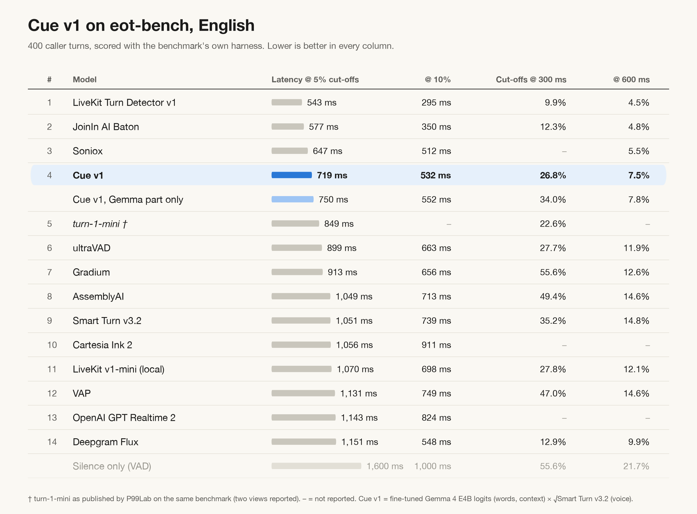
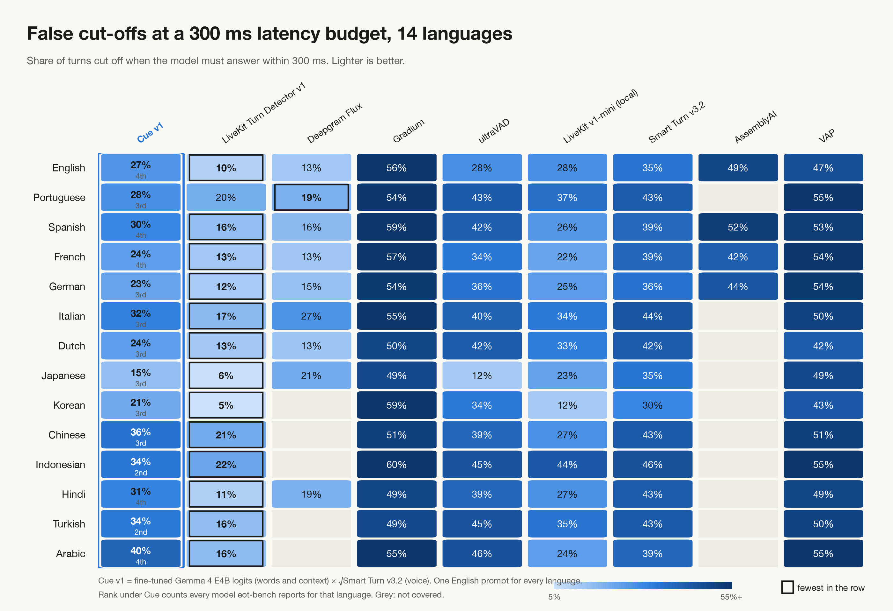
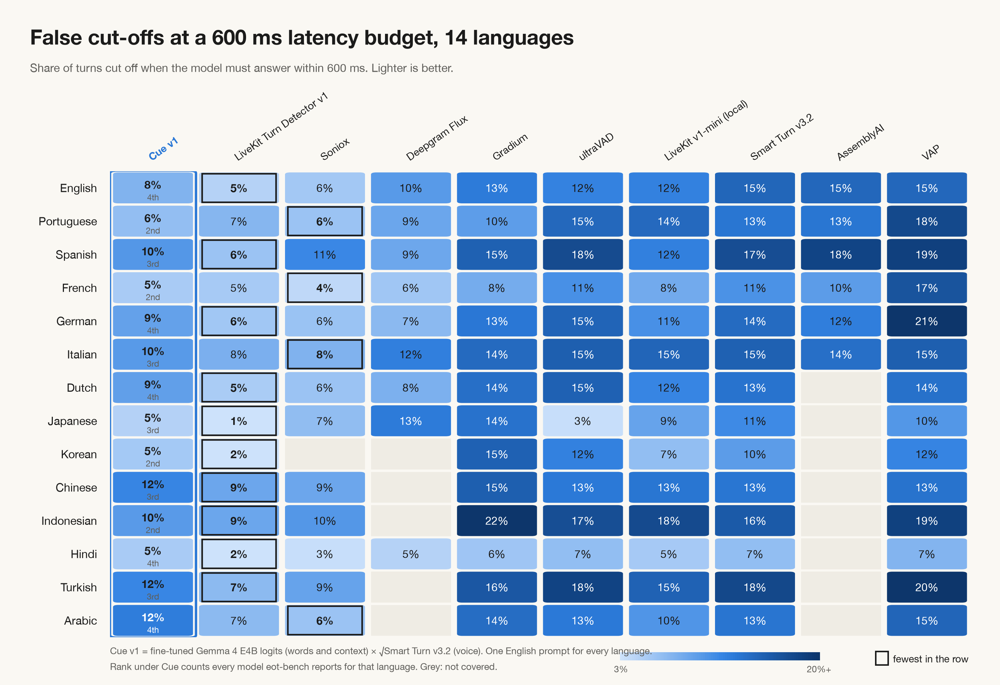
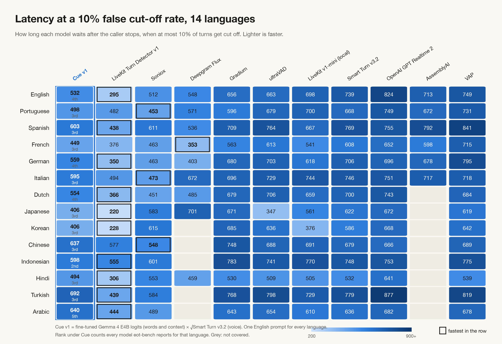

<div align="center">

# Cue v1

### Cue v1 solves turn-taking in voice AI agents by modelling it as a decision.

**Your voice agent stops cutting people off when they pause to think.**

[](https://huggingface.co/Pype/cue-v1)
[](LICENSE)
[](pyproject.toml)
[](livekit-integration/README.md)
[](#benchmarks)

**[Model on Hugging Face](https://huggingface.co/Pype/cue-v1) · [Watch the demo](#watch-it-on-a-live-call) · [Benchmarks](#benchmarks) · [LiveKit guide](livekit-integration/README.md)**

[Quick start](#quick-start) · [How Cue works](#how-cue-works) · [Use it in your code](#use-it-in-your-code) · [Use it in LiveKit](#use-it-in-livekit) · [Benchmarks](#benchmarks) · [FAQ](#faq)

`pip install "cue-turn @ git+https://github.com/PYPE-AI-MAIN/cue-v1"`

<br /><br />



</div>

---

Voice agents have to make one decision again and again, in every call: **should I talk now?**

Text agents get an Enter key. The user presses it, and the agent knows it's its turn. A phone call has no Enter key,
so most voice agents use a silence timer: wait for a fixed stretch of quiet, then reply. That's why they cut you off
when you pause to think, or halfway through reading out your phone number.

Cue v1 treats that moment as a decision. Every time the caller pauses, it asks one question: **are they done, and if
not, why not?** The answer tells your agent whether to reply now, give a short grace, or keep listening. While the
agent is talking, Cue answers a second question: is the caller really interrupting, or just saying "hmm"?

Cue v1 can't talk. It only decides, and it reads each answer from a single token. It is Gemma 4 E4B, fine-tuned on
these questions, reading the words; [Smart Turn v3.2](https://huggingface.co/pipecat-ai/smart-turn-v3), Pipecat's open
audio model, listens to the voice.

The model is open on Hugging Face ([Pype/cue-v1](https://huggingface.co/Pype/cue-v1), Apache 2.0). This repo gets it
running and lets you use it: from a terminal, from your own code, or in [LiveKit](livekit-integration/README.md).

## Watch it on a live call

https://github.com/user-attachments/assets/539d41b5-c190-4e3b-91f2-87def836bb1a

A live call in Shortwire, our voice stack, with Cue v1 deciding when the caller's turn ends (38 s; unmute for the
caller's voice, or [download it](assets/cue-v1-phone-number.mp4)):

1. The agent asks for a mobile number. The caller says "Yeah, so my number is…" and pauses. Cue answers
   **MID_THOUGHT (0.99)**, so the agent keeps listening instead of replying.
2. The caller reads out the digits in pieces. Here a separate Shortwire decision takes over: DICTATION, which is not
   part of Cue, recognises a phone number and holds the turn until it judges the number complete. Cue isn't asked
   while it does.
3. The agent reads the number back. "So," comes back MID_THOUGHT, and "That sounds good" comes back **DONE (0.97)**,
   so the agent replies.

## Quick start

```bash
pip install "cue-turn @ git+https://github.com/PYPE-AI-MAIN/cue-v1"
brew install llama.cpp      # Cue runs on llama.cpp (Linux and Docker: see "Serve it yourself")
cue demo                    # downloads Cue v1 once (about 8 GB), starts it, asks five questions
```

The model is 8 GB, so it needs a GPU with that much free memory: an NVIDIA card such as a T4, or an Apple-silicon Mac,
which llama.cpp runs on its GPU. It works on a CPU, only slower. The first run downloads the model into the Hugging
Face cache (`~/.cache/huggingface`); after that, starting takes seconds to a minute while the model loads.

What Cue v1 answers in the demo:

| The agent said | The caller said | Cue v1 |
|---|---|---|
| "What's the best number to reach you on?" | "Sure, it's nine eight four five," | MID_THOUGHT: p(done) 0.00, wait 1.75 s |
| "What's the best number to reach you on?" | "It's nine eight four five six seven one two three four." | DONE: p(done) 1.00, wait 0.51 s |
| "How can I help you today?" | "So last week I went to the clinic and the doctor told me that" | MID_THOUGHT: p(done) 0.00, wait 1.75 s |
| "Your appointment is on Tuesday at ten" (still talking) | "wait, Tuesday doesn't work" | STOP (0.998) |
| "Your appointment is on Tuesday at ten" (still talking) | "hmm" | CONTINUE (1.000) |

To keep it running and ask your own questions, serve it in one terminal and ask from another:

```bash
cue serve                       # http://localhost:8090/v1, until Ctrl-C
cue ask "Sure, it's nine eight four five," --agent-said "What's the best number to reach you on?"
cue ask "wait, Tuesday doesn't work" --barge-in --agent-said "Your appointment is on Tuesday at ten"
```

## How Cue works

Cue v1 answers two questions:

| | Answer | What it means | What the agent does |
|---|---|---|---|
| **End of turn** (the caller pauses) | **DONE** | A complete question, answer, request or statement | Reply now |
| | **LIKELY_DONE** | Probably finished, but it trails off | A short grace, then reply |
| | **MID_THOUGHT** | The sentence is left hanging: "my number is nine eight four five..." | Keep listening |
| | **HOLDING** | Telling a story or explaining something: the pause is thinking | Keep listening, longer |
| **Interruptions** (the caller speaks while the agent talks) | **STOP** | A real interruption: a question, a correction, "wait", "hello?" | Stop talking and listen |
| | **CONTINUE** | Only listening: "hmm", "okay", laughter, noise, a fragment | Keep talking |

- **The model.** Cue v1 is Gemma 4 E4B, fine-tuned on these questions.
- **One token, no text.** Each answer is read from a single token as probabilities over the states above, so nothing
  is generated. The agent learns not only *whether* to act but *how long to wait*.
- **Words and voice.** The model reads the words and the context: what the agent asked, and what the caller said.
  [Smart Turn v3.2](https://huggingface.co/pipecat-ai/smart-turn-v3) hears the voice. Together, as
  p(done) × √Smart Turn, they make the recipe behind every [benchmark](#benchmarks) below.

## Use it in your code

```python
from cue import Cue, p_end, serve, wait

server = serve()                  # or skip this and use a running server: Cue("http://localhost:8090/v1")
cue = Cue(server.url)

# the caller paused: are they done?
probs = cue.end_of_turn("Sure, it's nine eight four five,",
                        agent_said="Thanks. What's the best number to reach you on?")
# {'DONE': 0.0, 'LIKELY_DONE': 0.0, 'MID_THOUGHT': 1.0, 'HOLDING': 0.0}
p_end(probs)                      # p(the caller is done) = DONE + LIKELY_DONE
wait(probs)                       # how long to keep listening, blended by the answer: 1.75 s here

# the caller spoke over the agent: stop?
cue.barge_in("wait, Tuesday doesn't work", agent_said="Your appointment is on Tuesday at ten")
# {'STOP': 0.998, 'CONTINUE': 0.002}

# two people talking, not a caller and an agent
cue.dialogue_end_of_turn("I was thinking we could", other_said="What should we do this weekend?")

server.stop()
```

Every method has an async twin (`aend_of_turn`, `abarge_in`, `adialogue_end_of_turn`). `serve()` also works as a
`with` block.

### At each pause, in any voice stack

Ask Cue when your speech recogniser gives you the caller's words and they pause, then act on the answer:

- **Caller and agent:** reply when `p_end(probs)` crosses a threshold you tune on your own calls, for the cut-off rate
  you can accept. For the benchmarked recipe, add Smart Turn v3.2 on the caller's audio. It runs on the CPU and needs
  the `voice` extra: `pip install "cue-turn[voice] @ git+https://github.com/PYPE-AI-MAIN/cue-v1"`.

  ```python
  from cue import with_voice
  from cue.smart_turn import SmartTurn

  smart_turn = SmartTurn().fresh()       # downloads the model once; one fresh() per call
  smart_turn.push(pcm_16k)               # the caller's audio as it arrives (16 kHz mono)
  p = with_voice(cue.end_of_turn(words, agent_said=last_agent_message), smart_turn.predict())
  ```

- **Two people talking:** wait `wait(probs)` seconds of silence, and use the words alone. In our two-person tests,
  adding Smart Turn made it slightly worse.
- **Interruptions:** ask `cue.barge_in(words, agent_said=...)`, passing what the agent has said so far. Stop when
  p(STOP) ≥ 0.5, and ask again as more words arrive.

## Use it in LiveKit

Cue v1 drops into a [LiveKit Agents](https://github.com/livekit/agents) voice agent as its turn detector:

```python
from cue_livekit import CueTurnDetector

session = AgentSession(..., turn_handling={"turn_detection": CueTurnDetector("http://localhost:8090/v1"),
                                           "endpointing": {"min_delay": 0.3, "max_delay": 2.0}})
```

It also adds Smart Turn on the caller's audio, a fallback for when Cue doesn't answer, and Cue-decided barge-in. The
guide, with code for each: **[livekit-integration/](livekit-integration/README.md)**.

## Benchmarks

On LiveKit's [eot-bench](https://github.com/livekit/eot-bench): every caller turn in 14 languages, scored with the
benchmark's own harness. Every number here can be checked from the saved predictions, without a GPU
([Check our numbers](#check-our-numbers)).

**Fewer cut-ins.** At the same 0.8 s average reply time, an agent using Cue v1 cut in on **4.3%** of the pauses where
the caller wasn't finished, against 9.3% with a silence timer and 6.9% with Smart Turn v3.2 on its own. That's lower in all 14
languages; in English, 3.7% against 13.2%, 3.6× fewer.



**On the leaderboard.** Cue v1 is **4th of 13 in English** and **1st in Portuguese**, and in the top 4 in 13 of the 14
languages, with one English prompt for all of them. LiveKit's hosted turn detector is ahead of it everywhere except
Portuguese at a 5% cut-off rate, and French and Portuguese at a 600 ms budget. In English, at a 5% cut-off rate, Cue v1
replies after 719 ms on average; LiveKit's takes 543 ms and Smart Turn v3.2 alone 1,051 ms.




<details>
<summary>The other views: cut-offs at 300 ms and 600 ms, latency at 10%</summary>







</details>

[`eot-results/`](eot-results/README.md) has the full analysis:
- every language and every view;
- what helped and what didn't;
- every saved prediction, with one script that re-checks all the numbers using LiveKit's own harness, with no GPU.

### Check our numbers

```bash
git clone https://github.com/livekit/eot-bench && pip install -e eot-bench
python eot-results/verify.py --harness eot-bench      # ALL CHECKS PASS
python eot-results/cut_ins.py --harness eot-bench     # the cut-in chart: SAME AS cut_ins.json
```

What it checks, and how to re-run the benchmark from scratch: [`eot-results/`](eot-results/README.md#check-our-numbers).

## Serve it yourself

`cue serve` and `serve()` download `cue-v1-q8_0.gguf` from Hugging Face once and start llama.cpp's `llama-server`
with the flags Cue v1 was benchmarked with. The options:

| Option | What it does |
|---|---|
| `--port` | The port to serve on (default 8090) |
| `--host 0.0.0.0` | Serve other machines. Use it with `--api-key` (or `CUE_API_KEY`), or behind a firewall: the server has no other protection |
| `--gpu-layers 0` | CPU only: it works, but slower |
| `--model` | A local GGUF instead of the download |

Clients pass the same key: `Cue(url, api_key=...)`, or `cue ask --api-key`.

**llama-server** comes from llama.cpp:
- **macOS:** `brew install llama.cpp`.
- **Linux and Windows:** the [prebuilt releases](https://github.com/ggml-org/llama.cpp/releases), or a build with
  CUDA for an NVIDIA GPU.
- **Elsewhere:** set `CUE_LLAMA_SERVER` to its path.

To run it without this package, llama-server can fetch the model itself:

```bash
llama-server --hf-repo Pype/cue-v1 --hf-file cue-v1-q8_0.gguf -c 8192 -np 4 -ngl 999 --jinja --port 8090
# or on an NVIDIA GPU, with Docker (the model is kept in ~/cue-models between runs):
docker run --rm --gpus all -p 127.0.0.1:8090:8090 -v ~/cue-models:/models -e LLAMA_CACHE=/models \
    -e HF_HUB_CACHE=/models ghcr.io/ggml-org/llama.cpp:server-cuda \
    --hf-repo Pype/cue-v1 --hf-file cue-v1-q8_0.gguf -c 8192 -np 4 -ngl 999 --jinja --host 0.0.0.0 --port 8090
```

The Docker line answers only this machine. To serve others, publish `-p 8090:8090` and add `-e LLAMA_API_KEY=...`;
clients then pass the key.

Any OpenAI-compatible server that returns `logprobs` works too, such as vLLM: point `Cue` at its URL with the model
name it serves, `Cue(url, model="...")`. llama-server ignores the name.

**Speed.** One NVIDIA T4 answers about 13 decisions a second: 79 ms each one at a time, under 200 ms two at once.
That is roughly 20 concurrent calls per T4, an estimate ([Speed and cost](eot-results/README.md#speed-and-cost)).

## Prompts

The prompts are part of the model, and they ship inside the package (`cue/prompts/`):

| Prompt | Used by | Question |
|---|---|---|
| `end_of_turn_phone` | `end_of_turn` | End of turn, a caller and an agent (the eot-bench prompt, with 11 English examples) |
| `end_of_turn_dialogue` | `dialogue_end_of_turn` | End of turn, two people talking |
| `barge_in` | `barge_in` | Interruptions: STOP or CONTINUE while the agent is speaking |

Each is a JSON decision: an instruction, the options and what they mean, the inputs it reads, and worked examples.
`messages(decision, inputs)` renders it exactly as Cue v1 was trained and benchmarked; `tests/` check this byte for
byte. To ask with your own variant of the phone prompt, keep its input names and build them the same way:

```python
from cue import end_of_turn_inputs, load

probs = cue.ask(load("my_prompt.json"), end_of_turn_inputs(words, agent_said=last_agent_message))
```

## FAQ

**Do I need a GPU?**
The model is 8 GB. An NVIDIA GPU such as a T4, or an Apple-silicon Mac, runs it well; a CPU works, only slower. Smart
Turn, the voice half, runs on the CPU.

**Which languages does it work in?**
It was trained on English, and benchmarked with the same English prompt in 14 languages: Arabic, Chinese, Dutch,
English, French, German, Hindi, Indonesian, Italian, Japanese, Korean, Portuguese, Spanish and Turkish. At the same
0.8 s reply time, it cut in less than a silence timer and less than Smart Turn in every one of them.

**Do I need LiveKit?**
No. Cue is one HTTP call to a model server, so it fits any voice stack: ask it when the caller pauses. For LiveKit
Agents there is also a drop-in turn detector, with [a guide](livekit-integration/README.md).

**How is it different from a silence timer, or from Smart Turn?**
A silence timer waits the same time after every pause. Smart Turn hears how the voice sounds, but not what the words
mean or what the agent asked. Cue reads the words and the conversation, and uses Smart Turn for the voice.

**Why four answers, and not just "done or not"?**
The reason tells the agent how long to wait. MID_THOUGHT and HOLDING both mean "not yet", but a caller telling a
story needs a longer wait than one who stopped mid-sentence. `wait(probs)` turns the answer into seconds: 0.5 s for
DONE up to 2.25 s for HOLDING, blended by the probabilities.

**Is it the best turn detector?**
Not yet. LiveKit's hosted turn detector is ahead of it in English and most languages. Cue v1 is open, runs on your own
hardware, and tells you why it waited.

**How fast is it?**
79 ms per decision on one NVIDIA T4, one at a time, and under 200 ms two at once.

## Limits

- **The Gemma part reads words, not prosody.** That is what Smart Turn adds.
- **Short objections can pass as backchannels.** "Hmm, actually no" said over the agent comes back CONTINUE (0.94).
- **Fast budgets.** Under about 600 ms, Cue v1 cuts off more callers than the leaders (26.8% at 300 ms in English).
- **Needs a speech recogniser and a GPU.** It is not an on-device model.
- **Trained on English.** The other 13 languages run on the English prompt.
- **Arabic is the weakest language** (6th at a 5% cut-off rate). There the same recipe on the base Gemma was faster:
  794 ms against 815 ms.
- **Trained on simulated conversations.** Measure it on your own calls before relying on its probabilities.

## Part of Shortwire

Cue is the turn engine in **Shortwire**, Pype's open source voice AI stack. There, background decision models
handle how the call moves (when the caller is done, when to hold, when to stop talking), and the LLM focuses on
what the agent says. **Cue v1 works best with Shortwire.** We'll share more details soon.

## Licence

Apache 2.0 ([`LICENSE`](LICENSE)), the same as Gemma 4 E4B. See [`NOTICE`](NOTICE). To cite Cue v1, see
[`CITATION.cff`](CITATION.cff).
